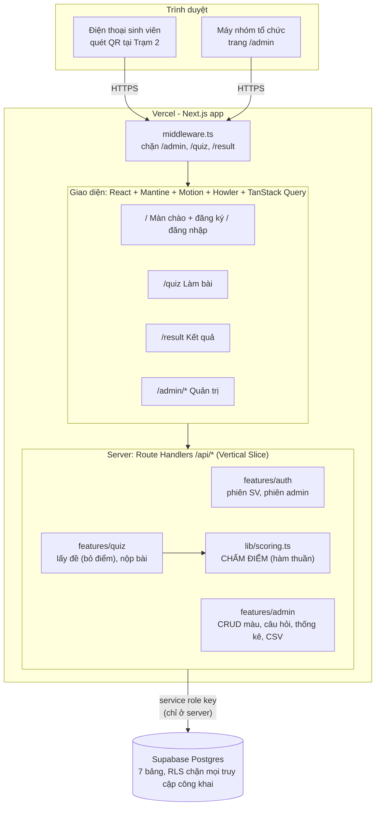
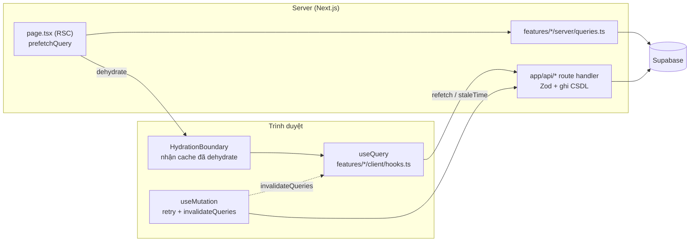

# KIẾN TRÚC HỆ THỐNG - IR DNA – FIND YOUR COLOR

Một ứng dụng Next.js duy nhất (giao diện + backend) chạy trên Vercel, dữ liệu trên Supabase Postgres. Trình duyệt **không bao giờ** gọi CSDL trực tiếp và **không bao giờ** nhận điểm của đáp án.

**Tên kiến trúc:** Modular Monolith full-stack chạy serverless, tổ chức theo **Vertical Slice Architecture** (mỗi tính năng một lát cắt `server/` + `client/` + `schema.ts`). Dữ liệu server do **TanStack Query** quản lý (SSR prefetch + hydrate), CSDL là Supabase (BaaS).

---

## 1. SƠ ĐỒ TỔNG THỂ



**Nguyên tắc:**
- Một giao diện responsive cho mọi thiết bị: điện thoại iOS/Android là chính, desktop và tablet dùng được đầy đủ (giao diện sinh viên nằm trong khung ~480px ở giữa màn hình lớn).
- Mọi truy cập CSDL đi qua `src/lib/db.ts` bằng service role key (biến môi trường Vercel). RLS bật trên mọi bảng, không có policy cho `anon`.
- Chấm điểm chạy trên server. Client chỉ gửi danh sách `id_dap_an` đã chọn.
- Backend chỉ là route handler trong `src/app/api/`, không dùng Server Actions.
- Một repo, một lần deploy. Không có server riêng phải bật/tắt.

## 2. LUỒNG SINH VIÊN

```mermaid
sequenceDiagram
	autonumber
	actor SV as Sinh viên
	participant App as Next.js (server)
	participant DB as Supabase

	SV->>App: Mở link (quét QR) → /
	SV->>App: Nhập mã SV
	App->>DB: Tìm sinh_vien theo mssv
	alt Đã có
		App-->>SV: "Chào Nguyễn Văn A" → xác nhận
	else Chưa có
		SV->>App: Nhập họ tên
		App->>DB: Thêm sinh_vien
	end
	App-->>SV: Cookie phiên (ký bằng SESSION_SECRET)
	SV->>App: Vào /quiz
	App->>DB: Lấy cau_hoi + dap_an đang bật (cache)
	App-->>SV: Bộ đề KHÔNG kèm điểm
	Note over SV: Làm 8–10 câu. Đáp án giữ tạm trên máy,<br/>chưa gửi; rớt mạng giữa chừng vẫn làm tiếp được
	SV->>App: Nộp danh sách id_dap_an
	App->>DB: Lấy diem_dap_an + mau_gen
	App->>App: scoring.ts: cộng điểm → % → xếp hạng → trộn màu
	App->>DB: Lưu 1 dòng vào ket_qua
	App-->>SV: /result: màu chính, ý nghĩa, xếp hạng 6 màu
```

## 3. TRANG VÀ QUYỀN TRUY CẬP

| Đường dẫn | Ai dùng | Cần phiên | Nội dung |
| :--- | :--- | :--- | :--- |
| `/` | Sinh viên | Không | Màn chào, nhập mã SV, họ tên nếu là lần đầu |
| `/quiz` | Sinh viên | Phiên SV | Mỗi câu một màn, thanh tiến độ dạng chuỗi DNA |
| `/result` | Sinh viên | Phiên SV | Hoạt ảnh giải mã → màu chính, ý nghĩa, xếp hạng 6 màu, màu riêng, lưu ý tham khảo, làm lại |
| `/admin/login` | Nhóm | Không | Mật khẩu chung `ADMIN_PASSWORD` |
| `/admin/mau-gen` | Nhóm | Phiên admin | Thêm/sửa 6 mã gen màu |
| `/admin/cau-hoi` | Nhóm | Phiên admin | Câu hỏi, 4 đáp án, chọn màu chính (+3) / phụ (+1); cảnh báo lệch màu |
| `/admin/ket-qua` | Nhóm | Phiên admin | Danh sách kết quả, biểu đồ tỉ lệ màu, xuất CSV |
| `/admin/qr` | Nhóm | Phiên admin | Mã QR của link app, tải PNG/SVG để in |

## 4. THUẬT TOÁN CHẤM ĐIỂM (`src/lib/scoring.ts`)

Hàm thuần, không gọi CSDL:

```ts
score(input: {
	colors: { id: number; hex: string }[];
	questions: { id: number; options: { id: number; points: Record<colorId, number> }[] }[];
	selected: number[]; // id_dap_an theo thứ tự câu
}) => {
	ranking: { colorId: number; points: number; max: number; percent: number }[]; // giảm dần
	topColorId: number;
	blendHex: string;
}
```

1. **Cộng điểm:** với mỗi màu, cộng `points` của các đáp án đã chọn.
2. **Điểm tối đa:** với mỗi màu, cộng điểm cao nhất màu đó có thể nhận ở từng câu.
3. **Phần trăm** = điểm / điểm tối đa (màu có tối đa = 0 thì 0%).
4. **Xếp hạng** giảm dần theo phần trăm. Hoà: ưu tiên màu được cộng điểm ở câu gần cuối nhất.
5. **Màu riêng:** trộn RGB của 2 màu đầu theo tỉ lệ phần trăm (VD 86% và 57% → 60:40).

Ví dụ kiểm thử bắt buộc: 3 câu, chọn 1A-2A-3A → Lam 6/7 = 86%, Tím 4/7 = 57%, Xanh lá 1/7 = 14% → màu chính Lam, màu riêng `#3D49A2` (xem tài liệu kế hoạch).

## 5. LUỒNG DỮ LIỆU (TANSTACK QUERY + SSR)



| Quy ước | Nội dung |
| :--- | :--- |
| Cache | Chỉ dữ liệu server. UI state ở `useReducer`/`useState` + `sessionStorage` |
| Prefetch | `page.tsx` gọi thẳng `features/*/server/queries.ts`, không tự gọi HTTP |
| Query key | Tập trung ở `src/constants/query-keys.ts` |
| Mặc định | `staleTime` 60 giây, `retry` 2 |

Áp dụng theo tính năng:
- **Nộp bài:** `useMutation` `retry: 3` có backoff; đáp án vẫn giữ trên máy nên rớt mạng không mất bài.
- **Bộ đề:** `staleTime: Infinity`, tải một lần (đã bỏ điểm).
- **Admin:** thêm/sửa/xoá xong `invalidateQueries`; trang kết quả `refetchInterval: 15s`; kéo thả thứ tự câu hỏi dùng optimistic update.
- **Devtools:** `@tanstack/react-query-devtools` chỉ bật khi dev.

## 6. ĐĂNG NHẬP & PHIÊN

| Đối tượng | Đăng nhập | Phiên |
| :--- | :--- | :--- |
| Sinh viên | Mã SV (+ họ tên lần đầu), không mật khẩu | Cookie httpOnly ký JWT (`jose`), 7 ngày |
| Admin | Mật khẩu chung `ADMIN_PASSWORD` | Cookie admin riêng, 12 giờ; giới hạn số lần thử |

Nâng cấp sau (nếu cần): Supabase Auth + đăng nhập Microsoft email trường, không đổi CSDL nội dung.

## 7. CẤU TRÚC THƯ MỤC

```text
ir-dna-find-your-color/
├── .ai/
│   ├── rules/          quy_tac_code.md, nguyen_tac_thiet_ke.md
│   ├── system/         kien_truc.md (file này), thiet_ke_csdl.md
│   └── skills/         design-taste-frontend, minimalist-ui, mantine-form,
│                       mantine-custom-components, git-commit
├── AGENTS.md           điểm vào cho AI (CLAUDE.md, GEMINI.md trỏ về đây)
├── src/
│   ├── app/                                   # page.tsx = Server Component thuần
│   │   ├── layout.tsx                         # Providers (Mantine + QueryClient), font
│   │   ├── page.tsx                           # màn chào + đăng ký/đăng nhập
│   │   ├── quiz/page.tsx
│   │   ├── result/page.tsx
│   │   ├── admin/
│   │   │   ├── login/page.tsx
│   │   │   ├── mau-gen/page.tsx
│   │   │   ├── cau-hoi/page.tsx
│   │   │   ├── ket-qua/page.tsx
│   │   │   └── qr/page.tsx
│   │   └── api/
│   │       ├── auth/student/route.ts, auth/admin/route.ts
│   │       ├── quiz/route.ts, quiz/submit/route.ts
│   │       └── admin/colors/, questions/, results/, export/   # route.ts
│   ├── components/                            # "use client"
│   │   ├── student/   WelcomeForm, QuestionCard, DnaProgress, DecodeAnimation,
│   │   │              ResultHero, ColorRanking, SoundToggle
│   │   ├── admin/     ColorEditor, QuestionEditor, BalanceWarning, ResultsTable,
│   │   │              ColorChart, QrPanel
│   │   └── shared/    Providers, StudentFrame (khung ~480px), Disclaimer
│   ├── features/                              # mỗi tính năng một lát cắt
│   │   ├── auth/  server/ (queries.ts, mutations.ts), client/ (api.ts, hooks.ts), schema.ts
│   │   ├── quiz/  server/ (lấy đề bỏ điểm, nộp bài), client/, schema.ts
│   │   └── admin/ server/, client/, schema.ts
│   ├── lib/
│   │   ├── scoring.ts           + scoring.test.ts
│   │   ├── db.ts                # Supabase client, chỉ server ("server-only")
│   │   ├── session.ts           # ký/đọc cookie SV và admin
│   │   ├── query-client.ts      # QueryClient (server: mỗi request, client: 1 bản)
│   │   └── sound.ts             # Howler, bật/tắt tiếng
│   ├── constants/  routes.ts, api-endpoints.ts, query-keys.ts, assets.ts, app.ts
│   ├── mock-data/  quiz.ts      # dữ liệu mẫu (prototype): 6 màu, 10 câu, điểm
│   ├── theme.ts                 # theme Mantine: màu, font, bo góc
│   └── middleware.ts            # chặn trang theo phiên
├── supabase/
│   ├── migrations/0001_init.sql
│   └── seed.sql                 # 6 màu + 10 câu mẫu
├── public/  sounds/ (mp3 CC0), icons/
├── .env.example  .prettierrc  package.json  next.config.ts  vitest.config.ts
└── README.md
```

## 8. CÔNG NGHỆ

| Nhóm | Thư viện | Phiên bản (npm, 13/10/2026) |
| :--- | :--- | :--- |
| Nền tảng | Next.js (App Router) + TypeScript, React | 16.4, 19.3 |
| Giao diện | Mantine (`core`, `hooks`, `form`, `notifications`, `charts`), `@tabler/icons-react` | 9.7 |
| Chuyển động | Motion, canvas-confetti | 14.1, 1.9 |
| Âm thanh | Howler.js | 2.2 |
| CSDL | `@supabase/supabase-js` | 2.117 |
| Dữ liệu server | `@tanstack/react-query` (+ devtools khi dev) | 5.104 |
| Kiểm tra dữ liệu | Zod | 4.6 |
| Phiên | jose | 6.2 |
| QR | qrcode.react | 4.2 |
| Test | Vitest (chỉ `scoring.ts`) | 5.0 |

## 9. BIẾN MÔI TRƯỜNG

| Biến | Nguồn |
| :--- | :--- |
| `SUPABASE_URL`, `SUPABASE_SERVICE_ROLE_KEY` | Vercel tự điền khi gắn Supabase (Storage), hoặc Supabase → Settings → API |
| `SESSION_SECRET` | Chuỗi ngẫu nhiên ≥ 32 ký tự |
| `ADMIN_PASSWORD` | Nhóm tự đặt |
| `NEXT_PUBLIC_APP_URL` | Link chính thức, dùng để sinh mã QR |
