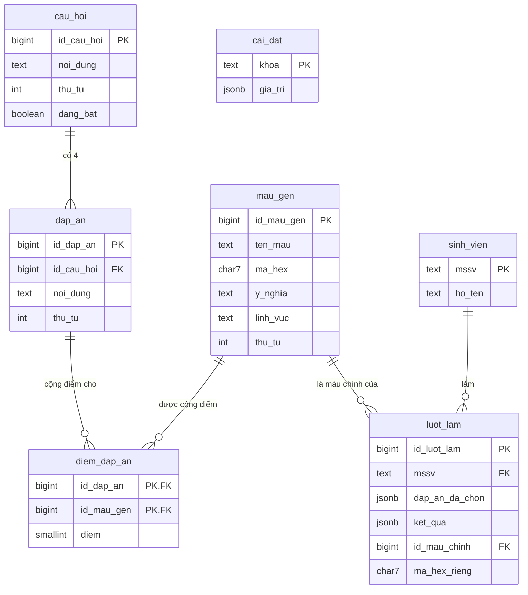

# THIẾT KẾ CƠ SỞ DỮ LIỆU - IR DNA – FIND YOUR COLOR

CSDL: **Supabase Postgres**. Quy ước tên: chữ thường, snake_case, tiếng Việt không dấu (xem mục 5 `.ai/rules/quy_tac_code.md`). Script chuẩn: `supabase/migrations/`.

---

## I. DANH SÁCH BẢNG (7 BẢNG)

| STT | Bảng | Nhóm | Chức năng |
| :---: | :--- | :--- | :--- |
| 1 | **`mau_gen`** | Nội dung (admin nhập) | 6 mã gen màu: tên, mã hex, ý nghĩa |
| 2 | **`cau_hoi`** | Nội dung | Câu hỏi trắc nghiệm, thứ tự, bật/tắt |
| 3 | **`dap_an`** | Nội dung | 4 đáp án của mỗi câu |
| 4 | **`diem_dap_an`** | Nội dung | **Ma trận điểm**: đáp án × màu → số điểm |
| 5 | **`sinh_vien`** | Phát sinh | Sinh viên đã đăng ký (mã SV, họ tên) |
| 6 | **`luot_lam`** | Phát sinh | Mỗi lần làm bài: đáp án đã chọn và ảnh chụp kết quả |
| 7 | **`cai_dat`** | Cấu hình | Cặp khoá–giá trị (cho làm lại, định dạng mã SV...) |

## II. SƠ ĐỒ QUAN HỆ

## III. CHI TIẾT TỪNG BẢNG

> **Trường audit:** `mau_gen`, `cau_hoi`, `dap_an` có `created_at TIMESTAMPTZ NOT NULL DEFAULT now()`, `updated_at TIMESTAMPTZ NULL`, `is_deleted BOOLEAN NOT NULL DEFAULT false`, `deleted_at TIMESTAMPTZ NULL`. Xoá là xoá mềm, để lượt làm cũ vẫn tra được màu và đáp án. `sinh_vien`, `luot_lam` chỉ có `created_at` (và `updated_at` cho `sinh_vien`).

### 1. `mau_gen`
| Cột | Kiểu | Ràng buộc | Mô tả |
| :--- | :--- | :--- | :--- |
| `id_mau_gen` | `BIGINT` | PK, identity | |
| `ten_mau` | `TEXT` | NOT NULL | VD "Xanh lam" |
| `ma_hex` | `CHAR(7)` | NOT NULL, CHECK `^#[0-9A-Fa-f]{6}$` | VD `#1E4FA3` |
| `ten_ma_gen` | `TEXT` | NOT NULL | Tên gọi mã gen hiển thị trên kết quả, VD "Gen Ngoại giao" |
| `y_nghia` | `TEXT` | NOT NULL | Diễn giải ý nghĩa, thế mạnh |
| `linh_vuc` | `TEXT` | NULL | Lĩnh vực/nghề nghiệp phù hợp (hiển thị ngắn) |
| `thu_tu` | `INT` | NOT NULL | Thứ tự hiển thị |

### 2. `cau_hoi`
| Cột | Kiểu | Ràng buộc | Mô tả |
| :--- | :--- | :--- | :--- |
| `id_cau_hoi` | `BIGINT` | PK, identity | |
| `noi_dung` | `TEXT` | NOT NULL | |
| `thu_tu` | `INT` | NOT NULL | |
| `dang_bat` | `BOOLEAN` | NOT NULL, DEFAULT true | Tắt thì không xuất hiện trong bài |

### 3. `dap_an`
| Cột | Kiểu | Ràng buộc | Mô tả |
| :--- | :--- | :--- | :--- |
| `id_dap_an` | `BIGINT` | PK, identity | |
| `id_cau_hoi` | `BIGINT` | FK → `cau_hoi`, NOT NULL | |
| `noi_dung` | `TEXT` | NOT NULL | |
| `thu_tu` | `INT` | NOT NULL | A=1, B=2, C=3, D=4 |

### 4. `diem_dap_an` (ma trận điểm)
| Cột | Kiểu | Ràng buộc | Mô tả |
| :--- | :--- | :--- | :--- |
| `id_dap_an` | `BIGINT` | PK, FK → `dap_an` | |
| `id_mau_gen` | `BIGINT` | PK, FK → `mau_gen` | |
| `diem` | `SMALLINT` | NOT NULL, CHECK `diem BETWEEN 1 AND 5` | Mặc định 3 (màu chính), 1 (màu phụ). Không có dòng = 0 điểm |

Chỉ lưu ô khác 0, nên mỗi đáp án thường có 1–2 dòng.

### 5. `sinh_vien`
| Cột | Kiểu | Ràng buộc | Mô tả |
| :--- | :--- | :--- | :--- |
| `mssv` | `TEXT` | PK, CHECK theo định dạng mã SV | Nhập trên điện thoại bằng bàn phím số |
| `ho_ten` | `TEXT` | NOT NULL | Tự viết hoa chữ đầu |

### 6. `luot_lam`
| Cột | Kiểu | Ràng buộc | Mô tả |
| :--- | :--- | :--- | :--- |
| `id_luot_lam` | `BIGINT` | PK, identity | |
| `mssv` | `TEXT` | FK → `sinh_vien`, NOT NULL | |
| `dap_an_da_chon` | `JSONB` | NOT NULL | Mảng `id_dap_an` theo thứ tự câu |
| `ket_qua` | `JSONB` | NOT NULL | Bảng xếp hạng lúc chấm: `[{id_mau_gen, diem, toi_da, phan_tram}]` |
| `id_mau_chinh` | `BIGINT` | FK → `mau_gen`, NOT NULL | Để thống kê nhanh tỉ lệ màu |
| `ma_hex_rieng` | `CHAR(7)` | NOT NULL | Màu trộn riêng của sinh viên |

`ket_qua`, `id_mau_chinh`, `ma_hex_rieng` là **ảnh chụp kết quả sinh viên đã thấy**, không phải dữ liệu phái sinh của trạng thái hiện tại (xem `nguyen_tac_thiet_ke.md` mục 1). Index: `(mssv, created_at DESC)` để lấy lượt gần nhất.

### 7. `cai_dat`
| `khoa` | `gia_tri` (ví dụ) | Ý nghĩa |
| :--- | :--- | :--- |
| `cho_lam_lai` | `true` | Sinh viên được làm lại hay không |
| `dinh_dang_mssv` | `"^[0-9]{10}$"` | Regex kiểm tra mã SV (nhóm xác nhận định dạng mã SV HUFLIT) |
| `so_cau_toi_da` | `10` | Giới hạn số câu đang bật |

## IV. QUAN HỆ & RÀNG BUỘC NGHIỆP VỤ

1. **`cau_hoi` – `dap_an` (1 - N):** mỗi câu đang bật phải có đúng 4 đáp án chưa xoá (kiểm tra ở trang admin trước khi bật câu).
2. **`dap_an` – `diem_dap_an` – `mau_gen` (N - N):** mỗi đáp án nên có đúng 1 màu chính (3 điểm), tối đa 1 màu phụ (1 điểm). Trang admin cảnh báo khi số lần làm màu chính của các màu lệch nhau quá 1.
3. **`sinh_vien` – `luot_lam` (1 - N):** nếu `cho_lam_lai = false`, server từ chối nộp bài khi sinh viên đã có lượt. Thống kê dùng lượt gần nhất của mỗi sinh viên.
4. **Bảo mật:** bật RLS trên cả 7 bảng, không tạo policy nào cho `anon`/`authenticated`. Chỉ server dùng service role key truy cập.
