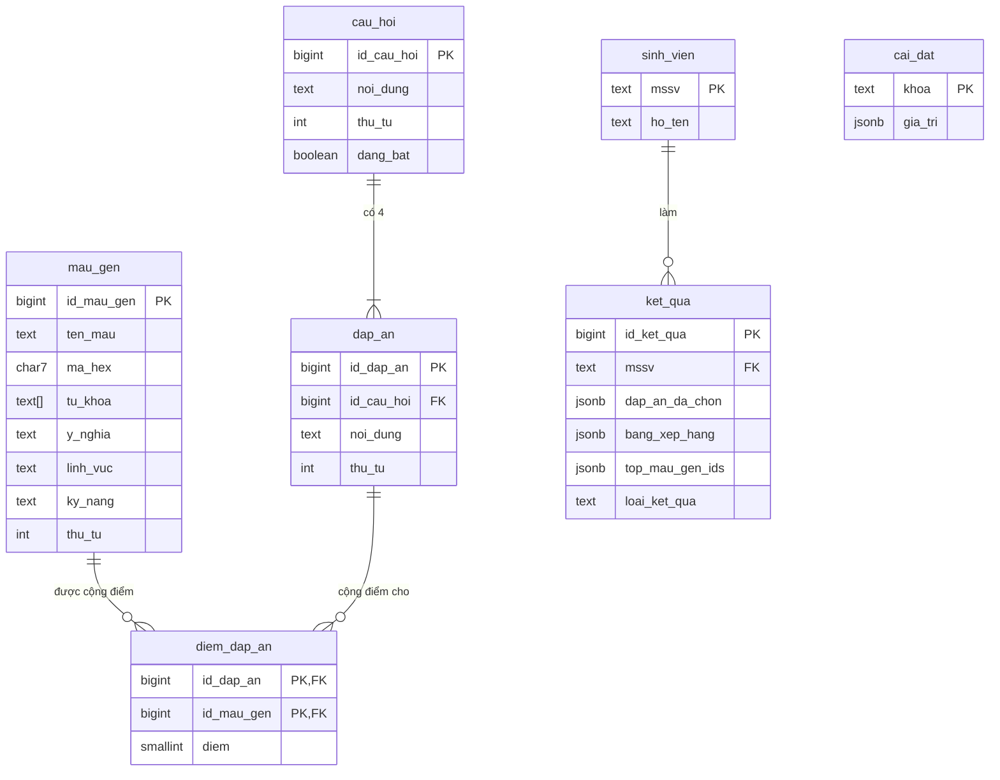

# THIẾT KẾ CƠ SỞ DỮ LIỆU - IR DNA – FIND YOUR COLOR

CSDL: **Supabase Postgres**. Quy ước tên: chữ thường, snake_case, tiếng Việt không dấu (xem mục 5 `.ai/rules/quy_tac_code.md`). Script chuẩn: `supabase/migrations/`.

---

## I. DANH SÁCH BẢNG (7 BẢNG)

| STT | Bảng | Nhóm | Chức năng |
| :---: | :--- | :--- | :--- |
| 1 | **`mau_gen`** | Nội dung (admin nhập) | 6 mã gen màu: tên, mã hex, từ khoá, ý nghĩa, kỹ năng |
| 2 | **`cau_hoi`** | Nội dung | Câu hỏi trắc nghiệm, thứ tự, bật/tắt |
| 3 | **`dap_an`** | Nội dung | 4 đáp án của mỗi câu |
| 4 | **`diem_dap_an`** | Nội dung | Ánh xạ mỗi đáp án tới đúng một gen, mỗi lựa chọn cộng 1 điểm |
| 5 | **`sinh_vien`** | Phát sinh | Sinh viên đã đăng ký (mã SV, họ tên) |
| 6 | **`ket_qua`** | Phát sinh | Mỗi lần làm bài là 1 dòng: đáp án đã chọn, điểm và danh sách gen cao nhất |
| 7 | **`cai_dat`** | Cấu hình | Cặp khoá–giá trị (cho làm lại, định dạng mã SV...) |

## II. SƠ ĐỒ QUAN HỆ



## III. CHI TIẾT TỪNG BẢNG

> **Trường audit:** `mau_gen`, `cau_hoi`, `dap_an` có `created_at TIMESTAMPTZ NOT NULL DEFAULT now()`, `updated_at TIMESTAMPTZ NULL`, `is_deleted BOOLEAN NOT NULL DEFAULT false`, `deleted_at TIMESTAMPTZ NULL`. Xoá là xoá mềm, để kết quả cũ vẫn tra được màu và đáp án. `sinh_vien`, `ket_qua` chỉ có `created_at` (và `updated_at` cho `sinh_vien`).

### 1. `mau_gen`
| Cột | Kiểu | Ràng buộc | Mô tả |
| :--- | :--- | :--- | :--- |
| `id_mau_gen` | `BIGINT` | PK, identity | |
| `ten_mau` | `TEXT` | NOT NULL | VD "Xanh lam" |
| `ma_hex` | `CHAR(7)` | NOT NULL, CHECK `^#[0-9A-Fa-f]{6}$` | VD `#1E4FA3` |
| `ten_ma_gen` | `TEXT` | NOT NULL | Tên gọi mã gen hiển thị trên kết quả, VD "Gen Ngoại giao" |
| `tu_khoa` | `TEXT[]` | NOT NULL | Ba từ khoá hiển thị trên kết quả |
| `y_nghia` | `TEXT` | NOT NULL | Diễn giải ý nghĩa, thế mạnh |
| `linh_vuc` | `TEXT` | NULL | Lĩnh vực/nghề nghiệp phù hợp (hiển thị ngắn) |
| `ky_nang` | `TEXT` | NOT NULL | Kỹ năng cần phát triển |
| `thu_tu` | `INT` | NOT NULL | Thứ tự hiển thị |

### 2. `cau_hoi`
| Cột | Kiểu | Ràng buộc | Mô tả |
| :--- | :--- | :--- | :--- |
| `id_cau_hoi` | `BIGINT` | PK, identity | |
| `noi_dung` | `TEXT` | NOT NULL | |
| `thu_tu` | `INT` | NOT NULL | |
| `dang_bat` | `BOOLEAN` | NOT NULL, DEFAULT true | Tắt thì không xuất hiện trong bài |

### 3. `dap_an`
| Cột | Kiểu | Ràng buộc | Mô tả |
| :--- | :--- | :--- | :--- |
| `id_dap_an` | `BIGINT` | PK, identity | |
| `id_cau_hoi` | `BIGINT` | FK → `cau_hoi`, NOT NULL | |
| `noi_dung` | `TEXT` | NOT NULL | |
| `thu_tu` | `INT` | NOT NULL | A=1, B=2, C=3, D=4 |

Index: `(id_cau_hoi)` để lấy đáp án theo câu.

### 4. `diem_dap_an` (gen của đáp án)
| Cột | Kiểu | Ràng buộc | Mô tả |
| :--- | :--- | :--- | :--- |
| `id_dap_an` | `BIGINT` | FK → `dap_an`, UNIQUE | Mỗi đáp án chỉ gán một gen |
| `id_mau_gen` | `BIGINT` | FK → `mau_gen` | Gen được gán cho đáp án |
| `diem` | `SMALLINT` | NOT NULL, CHECK `diem = 1` | Mỗi lựa chọn cộng đúng 1 điểm |

Mỗi đáp án phải có đúng một dòng; ràng buộc UNIQUE bảo đảm không gán nhiều gen cho một đáp án. Ứng dụng kiểm tra đủ dòng khi quản trị nội dung.

### 5. `sinh_vien`
| Cột | Kiểu | Ràng buộc | Mô tả |
| :--- | :--- | :--- | :--- |
| `mssv` | `TEXT` | PK, CHECK `^[0-9]{6,15}$` | Nhập trên điện thoại bằng bàn phím số. CSDL chỉ chặn ký tự không phải số; định dạng chính xác do server kiểm tra theo `cai_dat.dinh_dang_mssv` |
| `ho_ten` | `TEXT` | NOT NULL | Tự viết hoa chữ đầu |

### 6. `ket_qua`
| Cột | Kiểu | Ràng buộc | Mô tả |
| :--- | :--- | :--- | :--- |
| `id_ket_qua` | `BIGINT` | PK, identity | |
| `mssv` | `TEXT` | FK → `sinh_vien`, NOT NULL | |
| `dap_an_da_chon` | `JSONB` | NOT NULL | Mảng `id_dap_an` theo thứ tự câu |
| `bang_xep_hang` | `JSONB` | NOT NULL | Điểm của cả 6 gen lúc chấm |
| `top_mau_gen_ids` | `JSONB` | NOT NULL | Mảng ID của mọi gen đạt điểm cao nhất |
| `loai_ket_qua` | `TEXT` | NOT NULL, CHECK | `don`, `ket_hop`, `dong_hang` hoặc `da_sac` |

`bang_xep_hang`, `top_mau_gen_ids`, `loai_ket_qua` là **ảnh chụp kết quả sinh viên đã thấy**, không phải dữ liệu phái sinh của trạng thái hiện tại (xem `nguyen_tac_thiet_ke.md` mục 1). Index: `(mssv, created_at DESC)` để lấy kết quả gần nhất.

Ví dụ một dòng (bạn Minh, mã SV `2300001234`, bộ đề 3 câu minh hoạ):

| Cột | Giá trị |
| :--- | :--- |
| `id_ket_qua` | `1` |
| `mssv` | `2300001234` |
| `dap_an_da_chon` | `[11, 21, 31]` (mã của đáp án 1A, 2A, 3A) |
| `bang_xep_hang` | JSON bên dưới |
| `top_mau_gen_ids` | `[1]` |
| `loai_ket_qua` | `don` |
| `created_at` | `2026-11-20 09:15:02+07` |

```json
[
	{ "id_mau_gen": 1, "ten_mau": "Đỏ", "diem": 3 },
	{ "id_mau_gen": 2, "ten_mau": "Cam", "diem": 0 },
	{ "id_mau_gen": 3, "ten_mau": "Vàng", "diem": 0 },
	{ "id_mau_gen": 4, "ten_mau": "Xanh lá", "diem": 0 },
	{ "id_mau_gen": 5, "ten_mau": "Xanh dương", "diem": 0 },
	{ "id_mau_gen": 6, "ten_mau": "Tím", "diem": 0 }
]
```

`ten_mau` được chép vào để bảng xếp hạng cũ vẫn đọc đúng kể cả khi admin đổi tên màu sau này.

### 7. `cai_dat`
| `khoa` | `gia_tri` (ví dụ) | Ý nghĩa |
| :--- | :--- | :--- |
| `cho_lam_lai` | `true` | Sinh viên được làm lại hay không |
| `dinh_dang_mssv` | `"^[0-9]{10}$"` | Regex kiểm tra mã SV (nhóm xác nhận định dạng mã SV HUFLIT) |
| `so_cau_toi_da` | `10` | Giới hạn số câu đang bật |

Ba dòng trên được thêm sẵn với giá trị ví dụ trong `0001_init.sql`.

## IV. QUAN HỆ & RÀNG BUỘC NGHIỆP VỤ

1. **`cau_hoi` – `dap_an` (1 - N):** mỗi câu đang bật phải có đúng 4 đáp án chưa xoá (kiểm tra ở trang admin trước khi bật câu).
2. **`dap_an` – `diem_dap_an` – `mau_gen`:** mỗi đáp án phải gán đúng 1 gen và cộng 1 điểm. Trang admin cảnh báo nếu số lần xuất hiện của sáu gen lệch nhau (chuẩn: 8 lần mỗi gen trong 48 đáp án).
3. **`sinh_vien` – `ket_qua` (1 - N):** nếu `cho_lam_lai = false`, server từ chối nộp bài khi sinh viên đã có kết quả. Thống kê dùng kết quả gần nhất của mỗi sinh viên.
4. **Bảo mật:** bật RLS trên cả 7 bảng, không tạo policy nào cho `anon`/`authenticated`. Chỉ server dùng service role key truy cập.
